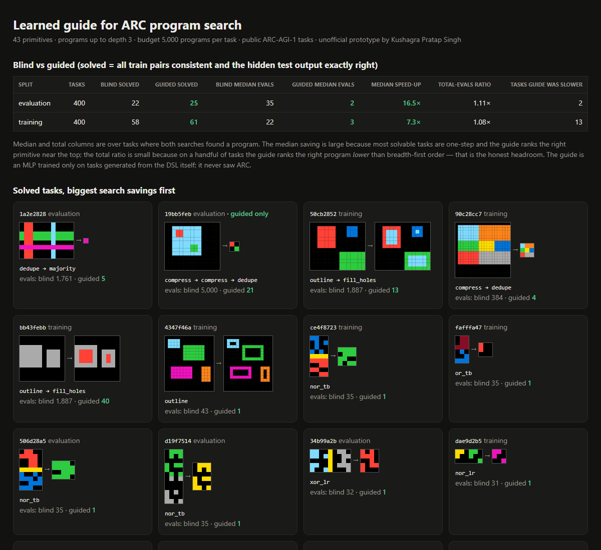

# Learned Guide for ARC Program Search

> Unofficial prototype by Kushagra Pratap Singh. Not affiliated with Ndea.

## The question

Ndea's bet is that program synthesis "searches for discrete programs ... that perfectly explain observed data", with deep learning guiding the search ([ndea.com](https://ndea.com)). The bottleneck is combinatorial explosion: even a small DSL has tens of thousands of depth-3 programs.

I wanted to see that trade-off end to end on real data, at laptop scale. **How much does a learned guide shrink the search, on which tasks does it help, and where does it hurt?**

## What I built

1. **A grid DSL with 43 primitives:** geometry, crop, largest/smallest object, scale/downscale, tile/mirror, self-Kronecker, gravity, halves, boolean ops across a separator, fill holes, outline, compress/dedupe, majority. A placeholder colour plus a **fitted colour map** at the end lets one primitive cover "fill with red" and "fill with blue".
2. **Enumerative search** over all 81,399 programs of depth ≤ 3, with **prefix caching** and a budget of 5,000 programs per task. A task counts as solved only if the program fits every train pair **and** reproduces the hidden test output exactly.
3. **The guide:** 26 task features (shape ratios, colour sets, symmetry, object counts, separators, sub-grid relations) feed a numpy **MLP** that outputs P(primitive is used). It is trained only on **18,000 tasks generated from the DSL itself** (random programs on random grids) and **never sees ARC**. Search runs best-first by summed log-probability.
4. **The benchmark:** blind (breadth-first) vs guided on all **800 public ARC-AGI-1 tasks** (400 training + 400 evaluation), with the same budget and the same cache. It runs in about 4 minutes on 8 CPU processes.



## Results

| Split | Tasks | Blind solved | Guided solved | Median programs checked (blind → guided) | Total-evals ratio |
|---|---|---|---|---|---|
| training | 400 | 58 | **61** | 22 → **3** (7.3×) | 1.08× |
| evaluation | 400 | 22 | **25** | 35 → **2** (16.5×) | 1.11× |

- **Six tasks are solved only with the guide**, because the right depth-3 program was beyond the blind budget. For example, `1c786137` is solved by `obj_largest → fill_holes → crop` after 890 evaluations (blind hit the 5,000 cap). `59341089` (`flip_lr → mirror_h → mirror_h`) took 196.
- **The guide never lost a task blind search solved.**
- **The honest part:** the *median* saving is large, but the *total* evaluations over tasks both methods solve drop only about 1.1×. On 15 tasks the guide ranks the right program **lower** than breadth-first order. A typical case is `dedupe → compress`, where both primitives look plausible and the order-free prior can't tell them apart. **Next step:** a guide that conditions on the *intermediate grid* after each step (execution-guided), not just the task, so the second primitive is chosen knowing what the first one produced.
- These are small numbers in absolute terms: about 15% of training tasks and 6% of evaluation tasks. A depth-3 hand-written DSL covers only the easy end of ARC, and that's expected. The point is the measurement loop, not the score.

Full per-task results are in [`docs/results.json`](docs/results.json).

## Run it (3 commands)

```bash
pip install -r requirements.txt
python fetch_arc.py && python bench.py      # downloads ARC (Apache-2.0), trains the guide, runs 800 tasks (~5 min)
python report.py && python -m pytest -q     # out/report.html, 10 tests
```

`python bench.py --quick` runs 60 tasks in about 30 s.

---
Unofficial prototype by Kushagra Pratap Singh. Not affiliated with Ndea. ARC-AGI data © François Chollet, Apache-2.0, downloaded at run time and not redistributed here.
